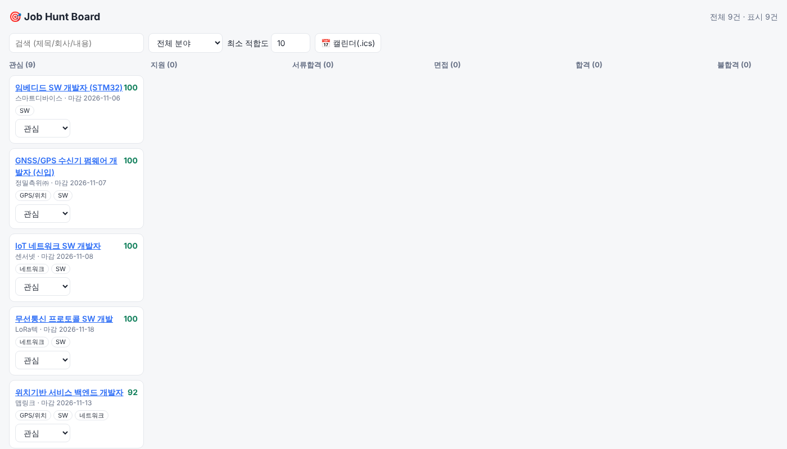

# 🎯 Job Hunt Command Center

GPS 송수신 캡스톤 경험과 네트워크·SW 직무에 맞춰 채용 공고를 모으고, 적합도를 점수화하고,
지원 현황을 칸반으로 관리하는 개인 취업 관리 도구입니다.



## 기능
| 구성 | 설명 |
|---|---|
| 수집기 | RSS / 공개 JSON API / JSON 파일 어댑터. URL 기준 중복 제거 |
| 분류기 | `jobhunter/profile.py`의 키워드 가중치로 0~100 적합도 + 분야(GPS·네트워크·SW) 분류 |
| 대시보드 | 칸반(관심→지원→서류합격→면접→합격/불합격), 검색·분야·점수 필터 |
| REST API | FastAPI. `/api/jobs`, `/api/stats`, `/api/deadlines`, `/api/calendar.ics` 등 |
| 텔레그램 봇 | `/top` `/deadline` `/stats`, 매일 09:00 마감 임박 알림 |
| 연동 | 마감·면접 `.ics`(구글 캘린더 가져오기), Notion 행 페이로드, 메일 제목으로 상태 자동 판별 |

## 실행
```bash
pip install -r requirements.txt
python -m jobhunter.cli collect-file data/sample_jobs.json   # 샘플(가상 공고) 적재
python -m jobhunter.cli collect-rss <RSS_URL>                # 실제 RSS 수집
python -m jobhunter.cli serve 8000                           # http://localhost:8000
TELEGRAM_BOT_TOKEN=... python -m jobhunter.bot               # 봇 (BotFather 토큰 필요)
pytest
```

## 데이터 출처 주의
`data/sample_jobs.json`은 **시연용 가상 공고**입니다(example.com 링크).
실제 수집 시에는 robots.txt와 이용약관이 허용하는 RSS·공식 API만 사용하세요.

## 구조
```
jobhunter/  profile.py(희망직무) classify.py collectors.py db.py api.py bot.py integrations.py cli.py static/
tests/      11개 테스트 (분류, API, 중복제거, ics, 메일판별, 봇)
```

## 다음 단계
- 실제 채용 RSS/API 어댑터 추가, 봇 배포(Fly.io/Render 등), Gmail·Notion 실연동
